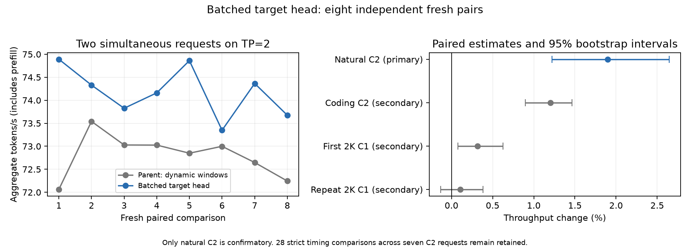
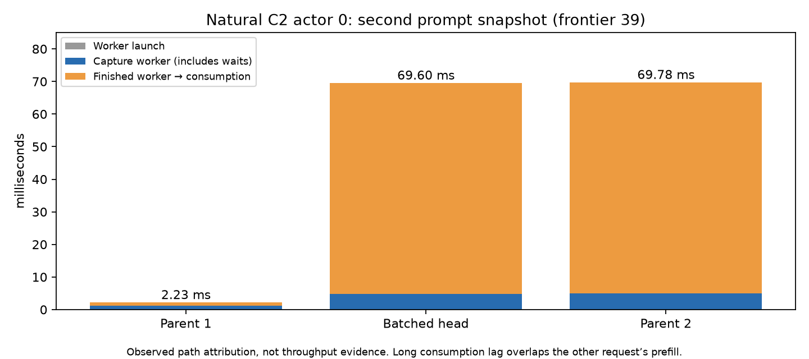

# TP2 batched MTP target-head verification

> Integration note: the measurements below belong to the original reviewed
> branch. The current-upstream port retains them as historical evidence and
> requires its own combined-model and performance validation. See the
> [integration checkpoint](../../patches/upstream-rdma-integration/README.md).

## Change and review scope

Previously, `ForwardBatch` computed the entire target output projection on both
ranks. For eligible packed MTP verification batches, each rank now computes half
the vocabulary and uses the existing target-head gather to reconstruct every
logit on both ranks. This removes duplicated projection work. Full output weights
remain resident on both machines; this is not a memory-saving change.

Eligibility is deliberately narrow: TP2, packed rows 2–7, all sessions using MTP,
the existing negotiated target-head gather, Q8_0 output with 248320 vocabulary
rows and 2560 hidden columns. All other paths retain the full projection.
Real-weight component measurements supported rows 2–7; larger shapes had mixed
results or regressed. Gathering copies logits rather than summing partial
floating-point results.

GPU-body failures abort the collective before stream synchronization, including
exception paths, so a peer is not left waiting for a collective that will never
be submitted. The transport version changes from 16 to 17: a version-16 peer
supports ordinary head gathers but would not issue the new batched collectives.
Both nodes must run matching builds. This branch is stacked on the dynamic host
window allocation change, with no driver, kernel, boot, ROCm or service changes.

## Independent serving measurement

Eight fresh, balanced randomized pairs compared the immediate dynamic-allocation
parent with this candidate: 16 starts and 192 requests. The protocol, endpoint,
seeds and stopping rule were fixed before acquisition; no requests were excluded,
replaced or pooled with earlier pilot/component/observed runs. The exact order
is in [design.json](tp2-batched-target-data/design.json).

| Endpoint | Parent tok/s | Candidate tok/s | Paired gain | Bootstrap 95% interval | Exact p |
| --- | ---: | ---: | ---: | --- | ---: |
| Natural C2 whole wave, primary | 72.7981 | 74.1804 | +1.8988% | +1.2218% to +2.6452% | 0.02857 |
| Coding C2 whole wave, secondary | 83.0750 | 84.0757 | +1.2045% | +0.8994% to +1.4655% | 0.02857 |
| First 2K C1 decode, secondary | 74.7549 | 74.9897 | +0.3142% | +0.0766% to +0.6258% | 0.02857 |
| Repeat 2K C1 decode, secondary | 74.7581 | 74.8364 | +0.1047% | −0.1312% to +0.3824% | 0.54286 |

Only natural C2 is confirmatory. Its gain was positive in all eight pairs and
passed the predeclared two-sided balanced-assignment test and positive confidence
interval. Secondary tests are unadjusted, not independent confirmatory claims.
C1 does not execute the changed batched projection body; no new C1 mechanism is
claimed. C2 means two concurrent requests; **both arms already use two TP nodes**.
C2 whole-wave throughput includes prefill; C1 decode rates exclude it.



The performance workload uses short C2 prompts and actual 2048-token C1 prompts.
65536 is context capacity, not the tested prompt length. The 32768-token prompt
in the performance client is a tokenizer identity sentinel; actual 32K execution
was separately tested for correctness. Settings: UD-Q4_K_XL target, shared Q8_0
MTP, greedy sampling, thinking off, two sessions, prefill chunk 2048, 1 GiB RAM
cache and request cache bypass. Both arms retain all parent optimizations.

All 192 canonical outputs and prompt/cache identities match. C1 MTP work matches
exactly. There are 72 adaptive-work metric differences across the 32 paired C2
actor comparisons; they are retained in
[adaptive-work.csv](tp2-batched-target-data/adaptive-work.csv). The serving gain
includes any resulting scheduling/policy changes and is not a pure kernel delta.
All 32 before/after transport windows passed, with unchanged runtime identities
and no startup failures in these 16 starts.

## Timing tradeoffs retained for review

[phase-flags.csv](tp2-batched-target-data/phase-flags.csv) retains all 28 strict
comparisons exceeding both 5% and 3 ms, including metric aliases, across seven
candidate C2 request IDs. They include startup TTFT, first-followup gaps and raw
snapshot-time increases. No new strict C1/warmup flag occurred in this study.
The cohort throughput gain does not waive individual-request regressions.

Some larger gaps followed a first event arriving about 70 ms earlier, but other
requests' second events were genuinely 35–57 ms later. One coding request's wall
time increased 191.8 ms (below the relative threshold); its peer/cohort still
finished faster. See the actual arrival differences in
[flagged-stream-arrivals.json](tp2-batched-target-data/flagged-stream-arrivals.json).
Equal event byte counts do not establish equivalent semantic token positions.

A separate, fixed parent/candidate/parent logging run traced 36 requests and 72
snapshot stages. These observations are not pooled into the performance study.
The snapshot metric was reconstructed exactly from launch through consumption:

```text
snapshot task launch
  -> worker starts
  -> mirrored capture acquires shared call mutex
  -> control send / local snapshot / remaining peer acknowledgement
  -> worker finishes
  -> main scheduler consumes ready future and records metric
```

For one natural C2 frontier, metric contributions were 2.23 / 69.60 / 69.78 ms
across parent/candidate/parent. Local snapshot work remained 1.06 / 1.16 / 1.21 ms;
the latter two cases spent about 64.8 ms between worker completion and scheduler
consumption, overlapping another synchronous prefill. The unchanged parent
therefore exhibits both modes. Across C2 stages, capture-mutex waits reached
66.55 ms, worker-to-consumer lag reached 102.66 ms, local snapshot wall time was
1.06–4.22 ms, and remaining peer acknowledgement wait was at most 1.51 ms.
These intervals overlap and must not be added as independent overhead.



The trace identifies shared scheduling/consumption delays in reproduced cases,
not a universal GPU launch tax, SSD service time or network latency. Some other
32–58 ms consumption delays were not assigned to a fully instrumented operation.
The coding TTFT flag did not recur in this trace. It does not establish equal tail
frequency or retrospectively explain the original untraced outliers. The original
28 flags remain open. Prior startup coalescing/priming experiments were negative
or inconclusive; this evidence alone does not justify repeating them or adding
prefill priority, which cannot consume an already-completed future.

## Correctness and evidence boundaries

The combined dynamic-allocation candidate passed 72 paired correctness cases per
rank at short and actual 32768-token contexts: 576 stage records, 96 new gathers
and 144 complete materialized state comparisons per rank. Full finite logits,
tokens, positions, external sampler RNG and proposal/accepted work match with
the gather enabled versus disabled. Greedy, sampled, mixed-sampler, packed rows
2–7 and fallback rows 8/9/10/12, mixed AR and pure AR paths are covered.
Normal HTTP cached continuation and cancellation/survivor tests also passed.
Matching-peer GPU sum, mixed-version rejection in both orders and forced legacy
VA-occupancy bootstrap tests passed.

Earlier wide C4/C6/C8, snapshot replay and injected failure tests exercised the
same batched body on the original fixed-address wire-15 prototype. Their
provenance is retained in the investigation; they were not rerun wholesale on
this wire-17 combined build. Simulated HIP API failure/peer exit are not physical
GPU/cable fault qualification. This draft does not claim universal latency
improvement, equal tail frequency, transparent reconnect or deployment approval.

Validation manifests: [quality](tp2-batched-target-data/quality-validation.json),
[cache/cancel](tp2-batched-target-data/cache-cancel-validation.json),
[bootstrap](tp2-batched-target-data/bootstrap-validation.json),
[build provenance](tp2-batched-target-data/build-provenance.json).

## Reproduction

From the repository root, validate the portable raw data without a GPU:

```sh
python3 docs/models/qwen3.8-flash-next/tp2-batched-target-data/check.py
python3 docs/models/qwen3.8-flash-next/tp2-batched-target-data/reproduce.py --help
```

[requests.json.gz](tp2-batched-target-data/requests.json.gz) contains every raw
request record, SSE arrival timestamp and metric. Exact prompts are compressed
alongside it. The checker verifies input hashes, all canonical identities and C1
work, the four paired summaries, 72 adaptive work differences and all 28 flags.
The statistical helper is [paired_statistics.py](tp2-batched-target-data/paired_statistics.py).

Build the parent and candidate independently using the same toolchain on both
nodes, enabling native RDMA:

```sh
cmake --preset release -DGUFO_ENABLE_TP2_RDMA=ON
cmake --build --preset release --parallel 4
```

Launch each matched pair using the existing RDMA setup procedure. The measured
CLI settings, applied on each node with its own rank, were:

```sh
build/release/gufo serve llm --model "$MODEL" --mtp-model "$MTP" \
  --served-model-name flash-next-tp-test --context 65536 --sessions 2 \
  --prefill-chunk 2048 --cache-ram-bytes 1073741824 --speculative mtp \
  --think off --host 127.0.0.1 --port 28530 --temperature 0 --seed 1 \
  --tp-world-size 2 --tp-rank "$RANK" --tp-bootstrap-host "$HEAD_IP" \
  --tp-bootstrap-port 28531 --tp-control-port 28532 \
  --tp-control-token "$CONTROL_TOKEN" --tp-rdma-device usb4_rdma0
```

Supply private shared control credentials and management-reachable head address;
do not commit credentials. MODEL and MTP file identities, exact measured binary
hashes and environment are in [workload.json](tp2-batched-target-data/workload.json).
Historical full-shard hashes were retained; the 112 GB model was not rehashed
during this study. Reused prompt/helper hashes were checked after the study
against prior frozen provenance rather than directly included in its freeze.

On each fresh server start, run the identical history once:

```sh
python3 docs/models/qwen3.8-flash-next/tp2-batched-target-data/reproduce.py \
  /tmp/fresh-history.jsonl http://127.0.0.1:28530
```

Use distinct output files and the exact 16-start order in design.json. The
portable client adapts input paths/loading and server selection; the serving
benchmark helper and request history match the measured client. Its command-line
and data checks pass, but this portable wrapper was not itself used to acquire
the original measurements. Preserve per-request metrics, outputs and startup
failures; verify the native driver/runtime and idle state around each start.
Do not add profiling, admin sampling, source/build writes, priming or full-table
warming during performance acquisition. Earlier incomplete fixed-address study
and pilot data remain separate; no replacement starts were used here.
