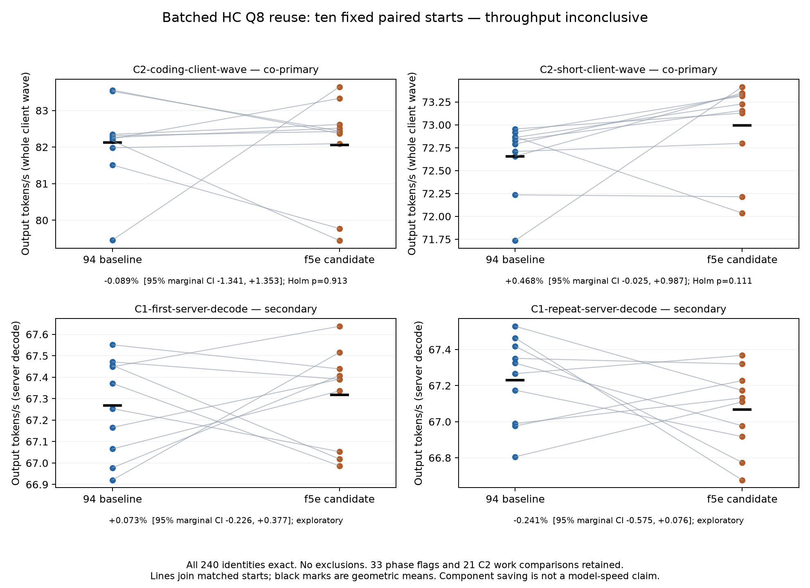

# Batched HC ready-Q8 review evidence

`HcMixBatch` emitted FP32 activations without the epilogue's existing optional
Q8 output. Decode-sized `DenseBatch` consumers then quantized the same input
again. This change emits the existing exact Q8_1 representation for at most
eight unpadded rows and publishes the existing readiness descriptor. Larger
rows retain their tiled/padded path. It adds no allocation, synchronization,
collective, user option, GPU arithmetic or public API change.

**The patch is for review, not qualified adoption.** Component work reduction
and functional correctness are measured; end-to-end throughput remains
inconclusive, with individual C2 latency flags retained.

Production source measured: `f5e9290cabf48dfeca521847dd60f3692b3c2927` on
maintained `94f1232d`. Later review additions are tests and evidence only. The
candidate executable replaces one production host object; every other model
archive member, GPU object and header is unchanged. Its CLI build metadata
still identifies parent94; the archived source and executable SHA identify the
actual candidate. This is not a new full CMake-release-build qualification.

## Measurements

| Scope | Result |
| --- | --- |
| Existing producer vs epilogue plus separate quantization | Exact FP32/injection/Q8 bytes in 30 conditions; 7200 latency records; per-condition median GPU saving 2.279–2.519 µs |
| Actual two-node serving activation |15,745 producer batches and24,874 matching ReadyQ8 uses per rank, rows1–8;12 exact outputs |
| Snapshot/RNG/full-score replay |104 records and32 complete post-replay state pairs per rank; short/32K, greedy/sampled, borrowed same/cross-session and serialized/file replay |
| Wider/ragged and mixed AR |1992 records and498 complete state pairs per rank; actual widths2–8, packed rows2–9/12, short/32K, greedy/sampled/mixed sampler |
| Cache and live cancellation |4cache case records plus9cancellation records; both victim roles, live width 2 survivor and exact solo/post-cancel replay |
| Added GPU operator contract |48 conditions across rows1–8, injection off/on and three magnitudes; exact optional-producer versus separate MMQ bytes and allocation-boundary guards; existing suite also passes |

The component's original injection allocation was larger than its produced
partial array: its exterior guards did not prove the exact injection boundary.
The added repository test uses `HcInjectParts` to place guards at that boundary.
Original records are retained; neither synthetic data nor model output goldens
were changed to accept a mismatch. Separate MMQ is an independent operator
path, not an external model teacher. Full state equality is checked within each
rank; this is not a claim of TP1/TP2 numerical identity.

The fixed unprofiled study used ten balanced randomized pairs, 20 fresh starts,
240 identical canonical requests, Qwen3.8-Flash-Next UD-Q4_K_XL with shared-Q8_0
MTP, 65K context **capacity**, two sessions,2048-token prefill chunks and 1 GiB
RAM cache. C1 prompts contain2048tokens; this is not65K prompt prefill. Native
81C6/TX32 and crossed 40+20 links stayed unchanged. There was no profiler, admin
sampler, parallel build or full-table warmup. No sample was excluded/replaced,
and no interim significance testing or pooling with earlier studies occurred.

| Metric | Baseline → candidate, tokens/s | Paired change |95% marginal CI | Holm p |
| --- | ---: | ---: | ---: | ---: |
| Coding C2, complete client wave |82.128→82.055|−0.089%|[−1.341,+1.353]%|0.913|
| Short C2, complete client wave |72.655→72.995|+0.468%|[−0.025,+0.987]%|0.111|

Both co-primary estimates are **inconclusive, not equivalence**. C2 whole-wave
rates include prefill, admission and terminal waiting; they are not the sum of
server decode rates. C1 first/repeat server-decode estimates are secondary
(+0.073%/−0.241%, both intervals crossing zero), with exact speculative work.
C1 was predeclared a negative control, but source tracing also finds wide
HcMixBatch calls during prefill. It is therefore reported as a secondary
single-stream control, without claiming the producer never ran. Primary tests
and statistical classification were not changed afterward.



## Latency limitations

All 20 starts pass source/binary/PID/options, actual MTP, output/prompt/cache,
transport counters, boot/topology, kernel and final idle checks. There are
**33 phase entries across 9 C2 request instances**, plus 21 C2 adaptive-work request
comparisons. No C1 phase flag or C1 speculative-work change occurred. Thresholds
remain both 5% and 3 ms; aggregate statistics do not waive a request flag.

The first C2 follow-up gap has roughly50/110ms modes on both sources. The long
mode occurred more often on this candidate sample: natural actor0baseline 1/10
versus candidate 4/10; coding actor0baseline 4/10 versus candidate 7/10. This is not
a causal frequency estimate or exoneration merely because baseline has it.
Actor0's flagged larger gap is offset by an earlier first token; its second
content event is not later (paired deltas−8.909to+0.059ms). Actor1's natural-C2
second event is **32.589–37.312ms later** in pairs 1/4/6, which remains a real
latency limitation; some histories have extra speculative rounds.

A separate fixed B/C/B source trace completes 36 canonical requests. It sees only
the normal short-gap mode, so it cannot explain away the untraced long-mode
flags. Snapshot workers take 2.65–4.24 ms while reported snapshot time is 93–102 ms;
89–98 ms falls between worker completion and scheduler consumption. Worker wall
also includes locking/GPU/communication and is not pure copying. Source/client
joins use same-host clocks, request lifetime and runner/implementation identity.
HC epoch markers after 100 ms gaps can show wide ineligible rows and do not count
all eligible producers. These traces are observer-affected and are not pooled
into the throughput estimate. This evidence does not justify another queue/preview patch or retry-until-
positive study from this evidence.

## Evidence and reproduction

[Archive metadata](batched-hc-ready-q8-data/archive.json) pins 584 hashed entries
in [acquisition.zip](batched-hc-ready-q8-data/acquisition.zip): source/scripts,
raw client/rank logs, component CSV, state assertions/hashes, runtime checks,
statistics and all retained failed fixture/build attempts. Executables, model
weights, object archives, control tokens and multi-GB snapshot payloads are
excluded. Snapshot byte comparisons ran in the captured probe. The offline
check audits evidence integrity and recorded coverage; it does not rerun GPUs,
assert mathematical quality independently or verify live hosts:

```bash
python3 docs/patches/batched-hc-ready-q8-data/check.py
```

Build/run commands and exact absolute lab paths are recorded inside each
acquisition. Reproduction needs fresh output directories and the pinned
models/runtime; existing acquisitions deliberately refuse overwrite. The wide
fixture's first attempt stopped in its unfused reference because a four-draft
ceiling did not guarantee twelve rows. The successful version distributes
zero/one proposals across actors, retaining the production confidence policy,
all widths, all numerical assertions and wider fallback coverage. A missing
multiarch OpenSSL include and old CLI archive ownership assumption also stopped
before their model acquisitions; those failures remain separate.

The next decision is review of a verified work reduction with unresolved
end-to-end evidence. No default adoption, significance claim, size-based
rejection, uniform-latency guarantee or TP1 qualification is implied.

## November 8 current-base follow-up

[Fresh production comparison and source traces](hc-c2-followup-2026-11-08.md)
use merged PR16 base59855a97 and current B6 driver, with each HC candidate built
separately. All 168 production request identities match; timing remains
inconclusive/confounded, and all flags are retained. Valid source observations
identify serial first native-MTP calls behind the common initial C2 gap;
recovered transport errors also occur in a diagnostic baseline. This evidence
addition changes no production code and does not qualify adoption or clear the
historical latency flags. The PR remains a draft.
