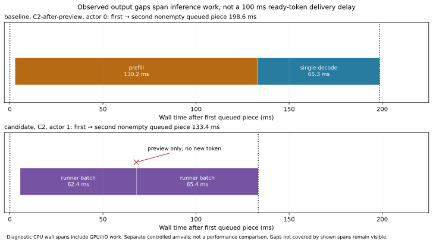

# First-output gap attribution

The observed long content gaps are not 100 ms delays delivering already-ready
tokens. New selections reached the publication function within **0.002–0.035 ms**
in 53 observed steps. The first two nonempty pieces reached their consumer within
**0.012–0.422 ms**. Client and producer first-gap durations differ by at most
0.280 ms in the eight examined request histories.

These are diagnostic CPU wall timestamps, including existing inference calls.
They do not measure pure GPU execution or establish a throughput improvement.
Inference calls may themselves contain computation, I/O, launch and wait costs.

## Direct measurements

| Source and controlled arrival | Actor | Producer first gap, ms | Observed contents of the interval |
| --- | ---: | ---: | --- |
| Stock, simultaneous | 0 | 68.458 | Serial decode; five selections return, one preview duplicate is suppressed, four new tokens publish |
| Stock, simultaneous | 1 | 109.775 | Two serial request steps; second actor's two selections return, preview duplicate suppressed, one new token publishes |
| Candidate, simultaneous | 0 | 67.837 | First joint cycle returns three selections, including preview; two new tokens publish |
| Candidate, simultaneous | 1 | 133.429 | First joint cycle returns only the preview; second cycle returns three new selections |
| Stock, peer starts after first visible token | 0 | 198.635 | Peer prefill 130.229 ms, then own serial decode 65.340 ms, plus other small intervals |
| Candidate, peer starts after first visible token | 0 | 200.513 | Peer prefill 131.134 ms, then own serial decode 66.046 ms, plus other small intervals |
| Stock, peer starts after first visible token | 1 | 210.344 | Other actor's serial step, then two joint cycles; first result is preview-only |
| Candidate, peer starts after first visible token | 1 | 189.875 | Other actor's serial step, then two joint cycles; first result is preview-only |

In the candidate simultaneous actor1 case, the two actual runner calls lasted
62.370 and 65.368 ms. At the first return (67.969 ms after the preview), the
request receives one selection and suppresses exactly one preview duplicate:
zero novel publications. At the second return (133.424 ms), it receives three
selections and publishes in 0.003 ms. This directly supports the preview/cycle
explanation in this observed history, rather than a queue delaying ready text.



The displayed wall spans include necessary inference work but are not a
CPU/GPU attribution inside that work. Nested snapshot, scheduler and engine
spans must not be added. The figures are separate histories, not a performance
comparison between sources.

## Why the early event-capture summary was too narrow

The earlier six-start capture deliberately stopped only for **actor0's first
follow-up gap** above95ms. It exhausted its cap without that particular event.
It did not establish absence of other high intervals: all six saved runs have
actor1 first gaps of109–138ms, and three have actor0 later gaps around113ms.
The separate `first-output-existing-trace-analysis-v1` reanalysis uses those
already-saved timestamps and source spans; it requires no replacement runs.

The original diagnostic v1 stock109.43ms first-gap occurrence still ends before
its first batched target forward begins. That source trace lacks the serial
publication probes added here. These newer controlled arrivals do not prove
which mechanism produced the original uninstrumented candidate108.8ms flag.

## Scope, checks and retained failures

- The stock baseline is canonical8ab834a5. The candidate is6ec3f75f, the same
  common-code HC change in upstream draft969. Their source/build libraries and
  headers are matched to canonical API0.1.15.
- The diagnostic adds scheduler return/preview/publication/queue/consumer,
  snapshot and prefill events to the priorv2 engine/batch/serial observers. No
  GPU wait, draft plan override, token/state arithmetic or system setting is
  added. The only newly changed archive member is the serving scheduler object;
  the model observers are the already-recorded matching diagnostic objects.
- Two client arrival histories are deliberately distinct from the original
  release screen's10ms stagger: simultaneous barrier, and peer submission after
  actor0's first useful SSE content. They are causal diagnostic workloads, not
  replacement samples or a confidence study.
- All22 qualified responses match between sources and their own solo controls:
  output hashes, prompt/cache work, actual MTP and physical width. The six
  pp2048 responses across the earlier B/C/B screen stopped96; this two-source
  screen has four such responses, also96. Coding requests produce128.
- **Five new diagnostic phase flags and eight work differences remain**, including
  candidate actor0 decode+170ms in simultaneous C2, actor1 first/max gap+23.8ms,
  and actor1 decode+188ms after-preview. They are separate from the original
  release screen's six flags/eight work differences. Logging, arrival order and
  adaptive work prevent a clean comparative latency attribution here. None is
  waived, and no equivalence or default adoption is established.
- The initial builder selected the wrong static archive. Its exact-member guard
  failed before any runtime; its files remain under `wrong-archive-*`. The
  corrected builder verifies the serving archive's unchanged member list and
  its one changed scheduler object.
- The original candidate client assumed actor0 was admitted first despite a
  simultaneous barrier; its admission assertion failed. Its five earlier client
  records and full server trace remain. The corrected client requires the same
  two admission occupancies in either order and saves records before checking.
  Only the candidate was rerun, using the identical diagnostic binary. A
  transient port preflight failure is retained; the continuation uses28634.
- All owned workers/servers exited. The maintained TP2 source, driver, kernel,
  system ROCm, boot flags, Halogen and disk-backed tables are unchanged.

## Reproduction

The original root is `/home/rkuo/strix-dispatch-investigation`. Sources, exact
compile/link commands, object-member checks, binary identities and run protocols
are retained in the sibling `first-output-publication-trace-v1` directory and
this directory. Controllers refuse to overwrite a protocol. Preserve failures
and use a fresh output directory for any hardware reproduction.

```sh
python3 tp-cache-retention/first-output-existing-trace-analysis-v1/analyze.py
python3 tp-cache-retention/first-output-publication-trace-v2/publication.py
.venv/bin/python tp-cache-retention/first-output-publication-trace-v2/plot.py
```

These commands analyze existing records and regenerate the standalone figure.
The original build/run commands are in the retained protocols. Source logging
may affect arrival timing and the adaptive controller; these binaries must not
be used for headline performance.

## Recommendations

Treat content-event gaps as output-progress measurements, not GPU-idle or pure
host-dispatch timers. Record returned selections, suppressed preview duplicates
and work per cycle when interpreting them. The observed publication stage does
not justify another preview/priority/cap patch or a driver/SSD investigation.

Peer prefill is a real, separately measured source of latency under new arrivals.
Changing its chunking or scheduling would need its own quality, C1 throughput,
prefill, cache and fairness qualification; this report does not demonstrate a
winning policy. Existing rejected variants remain rejected pending a distinct
measured mechanism. Keep the original untraced flag visibly inconclusive.

Return the scaling investigation to exposed computation/communication costs.
An independent RCCL collective baseline over the approved native USB4 path is
the next useful cross-check. Installed runtime/header version23004 and successful
read-only verbs queries on both hosts are recorded separately; no RCCL/vLLM
runtime or network collective result is claimed here.
