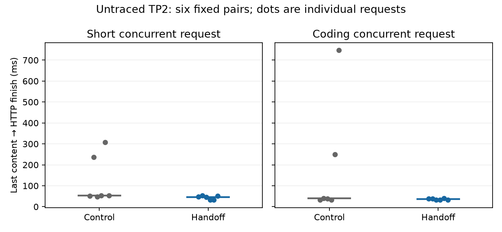

# Let completed TP2 requests finish between decode calls

After the scheduler publishes its terminal result, the HTTP request still calls
`TpRequest::Finish`: it sends the completed request's instruction count/digest to
rank 1 and waits for its verdict. `TpMirroredRunner::EndRequest` previously acquired
the shared recursive call mutex without announcing a pending turn. A sibling
could repeatedly reacquire that mutex for another decode, delaying the terminal
HTTP response after the last content token had already reached the client.

Reserve a pending turn with the existing snapshot gate before acquiring the
mutex, and release that reservation once acquired. Already running GPU work
finishes normally; subsequent decode/advance calls yield at their existing gate.
The instruction stream, verdict checks and model math remain unchanged. There is
no additional collective or option. This does not preempt an active call or add
ordering to prefill calls.

## Evidence and limits

On the parent release build (`ac8f6ed7`), an untraced coding request delivered its
last content token slightly earlier in the batched-head arm but returned its final
HTTP result later: the post-content tail was 40.0 versus 824.9 ms. Long tails also
occurred in the ordinary-head control, up to 749.9 ms. These observations motivated
this separate fix; they are not measurements of this fix's gain.

CPU traces excluded scheduler completion and commit as the slow phase. Direct
`Finish`/`EndRequest` spans place 98–99% of observed 32–54 ms finish time in the call
mutex; worker response then takes less than 1 ms. A separate 399.7 ms tail overlapped
eleven uninterrupted peer decode cycles. This is application finalization, not
per-token compute or the USB4 collective's transfer latency.

The included sparse captures replay the same twelve-request history on actual
TP2 models, three fresh processes per arm. Both use the combined target-head
release implementation. Only the candidate's pending handoff differs. Both arms
have the same bounded in-memory markers around `Finish` and `EndRequest`, with no
markers in the greedy decode path. All 72 request output/prompt/cache-work
identities match. C2 adaptive work may vary and is retained in the raw records.

| First-finishing request | Control worst mutex wait | Candidate worst mutex wait |
| --- | ---: | ---: |
| Short C2 | 71.47 ms | 51.89 ms |
| Coding C2 | 117.56 ms | 38.01 ms |

These are exploratory ranges over three histories per arm, not confidence bounds
or an inferential throughput claim. The remaining one-call wait is expected.
Untraced confirmation and current-patch cache/cancellation checks now pass as
described below; current-candidate process-local failure/recovery checks also pass.
The patch stays a draft with unresolved timing flags. Earlier head-optimization confidence results are
separate and are not pooled with these profiles.

The first complete control history was retained after the collector wrongly
expected a worker-side trace. These two hooks run only on the HTTP head, so no
worker trace is emitted. The remaining five histories resumed with corrected
collection; the completed control was not repeated or excluded. Both-node PID,
boot, topology, driver-counter, kernel and final-idle checks passed.

Environment: two 128 GB Strix Halo nodes, gfx1151, private ROCm 7.14.1, Clang 23,
Linux 7.3.0-strix-test, unchanged approved driver `81C6FF2FBAC473C7AB21844`, four rails
on crossed 40+20 Gb/s links, mapped host windows. Model: Qwen3.8-Flash-Next
UD-Q4_K_XL with shared-Q8_0 MTP, greedy, context capacity 65,536, two sessions,
scheduler chunk 2,048 and RAM cache 1 GiB; requests bypass cache reads. Actual
prefixes in the focused concurrent cases are short, not 64K prompts. Worker
verdict responses use the TCP control channel; the intervals below are not RDMA
payload latency measurements.

## Untraced confirmation

Six fixed pairs with balanced control/candidate order replayed the same history
on fresh model processes: 144 requests, all output/prompt/cache-work identities
exact. Both binaries have tracing removed. The candidate replaces only
`tp_executor.cpp.o` with the committed production change at `5ba11d7b`; every
other release/GPU/native object is unchanged. The binary embeds the parent
revision, so the [manifest](untraced/manifest.json) records both source and binary
identities explicitly.

Client-measured last-content-to-HTTP-finish latency for the first-finishing actor:

| Request (six per arm) | Control median | Candidate median | Control worst | Candidate worst |
| --- | ---: | ---: | ---: | ---: |
| Short C2, actor 1 | 53.38 ms | 46.36 ms | 306.94 ms | 52.77 ms |
| Coding C2, actor 0 | 40.02 ms | 35.94 ms | 746.83 ms | 39.32 ms |



This confirms the completion-tail effect without tracing. It is a descriptive
sample, not a universal latency bound or throughput significance claim. Unaffected
C1 pp2048/tg128 preserves exact proposal/acceptance/round/width work; median
server-accounted decode is 67.41 versus 67.47 tokens/s, with no speed claim.

Thirteen [per-request timing flags](untraced/timing-flags.csv) exceed both 5% and
3 ms and are retained. Coding TTFT has approximately 253/316 ms modes in both
arms; maximum inter-token times also vary in both. Pair 4 candidate short actor 1
is 322.7 ms slower wall / 345.6 ms slower server-accounted decode than its matched
control, with 45 versus 42 draft rounds. Another candidate has the same actor's
79 proposals / 62 accepted / 45 rounds but 153.6 ms less decode time. Adaptive
work alone therefore does not explain the entire outlier. Both actors exhibit
shared 75–124 ms streaming pauses in the slower run, ending 1.7–1.9 seconds before
the first final content token; [client gap localization](untraced/pair04-shared-gaps.json)
does not assign those pauses to a CPU, GPU, storage or transport cause. These
flags remain inconclusive and advisory; they are not waived or called fixed by
the request-finalization change.

Current-candidate greedy/sampled cached continuation passes for keeping and
discarding interrupted assistant output. C2 cancellation in either slot preserves
the live width-2 survivor's solo output and subsequent victim replay. The
[lifecycle report](untraced/lifecycle-validation.json) records these four cache
cases and nine cancellation/control records; these are not thirteen HTTP calls.
Checked transport error deltas are zero; process/boot/topology/kernel and final
idle checks pass. The [host report](untraced/host-validation.json) is the original
correctness gate output: its legacy `records_per_variant: 12` field means records
per **start**, with 72 per arm and 144 total here.

Reproduce all client identities, first-finisher tails and timing flags with:

```sh
python3 docs/patches/tp-request-end-handoff/untraced/verify.py
```

The verifier checks the included raw client records and hashes. It does not
independently recreate the original host environment. Instrumented and untraced
studies are kept separate.

## Current-candidate process-local failure containment

The [fault report](untraced/fault-validation.json) pins new return-PC and live
`ForwardBatch` ancestry checks against the untraced candidate executable. The
injection shim and its seven CPU-only negative/positive controls are unchanged
and reused by exact source/artifact hashes; previous production failure results
are not reused. A fresh current-engine control precedes the three injected cases.

Simulated rank-0 and rank-1 HIP copy API errors, and task-owned rank-1 process
exit, each produce explicit non-normal errors on both concurrent streams without
timeout. Complete capture durations are 0.603, 0.912 and 0.932 seconds respectively;
these include request admission/prefill and are not pure abort latency. A fresh
process pair after each fault reproduces all nine recovery outputs and
proposal/acceptance/round/width work exactly. Fourteen rank/phase transport-counter
windows have zero checked error deltas; kernel, frozen source/harness/settings,
boot/topology, process cleanup and final idle checks pass.

This qualifies simulated process-local failure containment and fresh recovery. It
does not establish physical cable-loss handling, actual GPU hardware-fault
recovery, or transparent reconnection within the same model processes.

## Reproduction

With the documented source-build dependencies:

```sh
cmake --preset cpu-test
cmake --build --preset cpu-test --parallel 4 --target tp_executor_test tp_snapshot_gate_test
ctest --test-dir build/cpu-test -R '^(tp_executor_test|tp_snapshot_gate_test)$' --output-on-failure
python3 docs/patches/tp-request-end-handoff/verify.py
```

The executor test retains equal-budget batching checks and adds unequal 2/32 and
8/32 budgets in both arrival orders for AR, greedy MTP and sampled MTP. A two-token
request may finish from preview before batching; longer cases must still batch.
Every result matches its independent control, both ranks' model calls agree and
both requests settle. The gate test covers reservations, recursive turns, unwind
and concurrent users. Both focused CPU suites pass.

The [manifest](data/manifest.json) pins compressed and uncompressed hashes for the
raw client histories and master CPU spans. The verifier reproduces
[the per-request timing table](summary.csv) and [the verification summary](verification.json).
It uses each host's local monotonic clock and never subtracts timestamps across
machines. PID and virtual-address values are trace correlations only.
