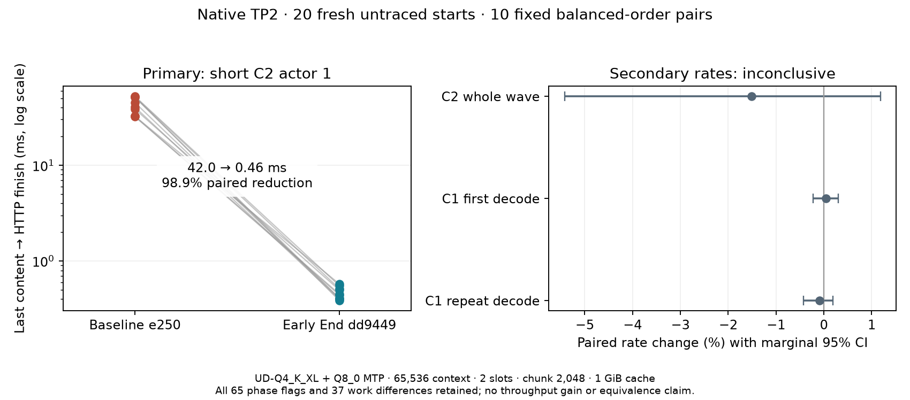

# Queue TP request End before the next scheduler turn

A finished streamed request can wait behind a sibling's next model step before
its HTTP thread queues End. Queueing End after successful cache commit or
cancellation, before the next scheduler turn, removes this completion delay.
The HTTP consumer still waits for the peer verdict and dependency settlement.
Model failures retain caller-side fallback. The corrected weak callback and
runner/broker ownership avoid a scheduler ownership cycle.

Production candidate: `dd9449e690f5ff4e916c05b3e2be2397e05fd217`.
Baseline: maintained `e250a07cfe1c9fcb0905c9b1cfca438261248c81`.
This is independent of the shared PLE-read patch in PR #12. No PLE wire22,
model arithmetic, driver, boot, or ROCm change is included here.

## Measured results

Twenty fresh untraced starts, ten predeclared balanced-order pairs, 100 exact
output/prompt/cache-work identities. The single primary endpoint is short-C2
actor 1's last-content-to-HTTP-finish time. No pairs were excluded. The actor
finished first in all twenty arms.

| Metric | Result | Paired bootstrap 95% interval |
|---|---:|---:|
| Primary completion tail, geometric mean | 41.974 → 0.459 ms; 98.906% reduction | 98.711–99.064% reduction |
| Secondary C2 whole-wave rate | −1.513% | −5.423 to +1.185% |
| Secondary first C1 decode | +0.0405% | −0.226 to +0.301% |
| Secondary repeated C1 decode | −0.0946% | −0.422 to +0.187% |

All ten primary pairs improve. The balanced-order assignment sensitivity p-value
is 0.00794. The sign-flip p-value is 0.00195 and assumes pairwise symmetry.
The complete-wave and C1 results are inconclusive, not equivalence or throughput
gains. All 65 strict phase entries across 11 request comparisons and 37 changed
adaptive-work fields remain visible. Startup high modes, C2 gaps/cache accounting
and slower candidate waves are unresolved; the primary result does not waive them.



The earlier diagnostic B/C/B trace has 15 exact outputs and six audited windows:
actor 1 tails 51.280 / 0.595 / 52.090 ms and maximum EndRequest durations
50.817 / 0.015859 / 51.588 ms. It supports the scheduling mechanism and is not
pooled into the untraced study or a completed-network-transfer measurement.

## Additional qualification

- Fresh production HIP release, BUILD_TESTING=OFF, RDMA=ON. All 274 model/family/core
  compiler/source entries match baseline after root and recorded diagnostic
  revision-label normalization. The binary hash is in the archive's build manifest.
- Twelve-output native replay, four cache and nine cancellation case records pass.
- Five focused CPU suites cover the unchanged scheduler/header/test implementation
  from the initial prototype. New cases exercise terminal/next-turn order, queued
  cancellation, callback exceptions and model-failure fallback. These CPU tests do
  not compile the HIP-only backend; the production build and runtime checks do.
- Wider fixed B/C/B: 60 exact controls and C3/C4/ragged requests; observed resident
  and physical widths reach three/four. Every candidate wave completion tail is
  below 1 ms. Six phase entries for one ragged 33-token request and 25 work fields
  remain. This is functional/order coverage, not statistical throughput evidence.
- Live rank1 userspace table-read EIO and exact task-owned peer SIGINT after eight
  content pieces: explicit stream errors, no normal completion, both failed
  processes exit and new connections are refused. Two independent fresh recoveries
  reproduce all eight outputs with actual MTP. The four-request initial control
  and normal shutdowns also pass. This is not a physical cable/drive fault or
  transparent reconnect test. The read-error fixture is scoped to one aligned
  O_DIRECT pread and reuses a previously validated preload; no device setting changes.
- Across the three exported studies, all 56 per-rank transport windows, same-boot
  configuration/topology checks, final idle state and kernel audits pass. Expected
  peer-loss deltas remain separate. The approved module is 81C6, TX32, active poll0,
  four rails with crossed 40+20 Gb/s links; the HTTP HCA is usb4_rdma0.

## Offline audit and reproduction

Run `python3 check.py` from this directory. It uses only the standard library,
checks the archive and every indexed file, replays the predeclared primary
statistics from the original raw outputs, rebuilds all 65 phase flags and 37 work
fields, and audits wider controls, explicit failures and the 56 transport windows.
The separate `dispatch-trace.zip` contains the 15 diagnostic outputs and raw
paired app spans; the auditor also recomputes all 15 End/Send decompositions.
Source/compiler/CI provenance is recorded separately; this does not rerun GPU
inference or verify historical hardware by itself. `plot.py` needs matplotlib.

`acquisition.zip` contains all original study controllers, request scripts,
server launchers, frozen protocols/settings, source/binary/build manifests,
per-rank inventories and counter snapshots, raw JSONL and summaries. The exact
original commands from the project root were:

```bash
bash tp-cache-retention/fork-integration-v1/build-early-end-v2-release.sh
bash tp-cache-retention/fork-integration-v1/run-early-end-v2-qualification.sh
python3 -u tp-cache-retention/early-end-wider-concurrency-v1/run.py
python3 tp-cache-retention/early-end-wider-concurrency-v1/analyze.py
python3 -u tp-cache-retention/early-end-live-faults-v1/run.py
python3 tp-cache-retention/early-end-live-faults-v1/validate.py
```

The launchers use the existing `cable-prep/env.sh` and `native-rdma/env.sh`, private
ROCm 7.14.1/Clang23, Linux 7.3.0-strix-test and gfx1151. Both hosts have
`ttm.pages_limit=32505856 amd_iommu=off`, with legacy gttsize disabled. Model:
Flash-Next UD-Q4_K_XL plus shared-Q8_0 MTP, greedy/thinking off, 65,536 context
capacity, chunk2,048, 1 GiB cache; two slots in the primary study and four in the
wider test. A 65,536 capacity is not a 65K prompt: C1 uses pp2048/max128 and C2
uses the fixed short prompts in the archived request script. Preserve prompt,
cache and fresh-process history when comparing results.

The archived controllers deliberately refuse an existing protocol and verify
exact binary/source identities. To repeat acquisition, use fresh study directories,
update the explicit lab paths in the archived harness, rebuild matching peers,
and retain the original studies. Do not overwrite these artifacts, install a
new kernel/driver, enable the disabled hardware-counter shim, or warm the full
n-gram table. Launch stdout/stderr and control-token files are not exported.

The initial f5d9c2c5 prototype study stopped at a completed-arm boundary after
15 arms/75 records for the ownership correction, independently of efficacy.
Those partial records remain in the lab and are not pooled or used for final
inference. Portable export v1 omitted the standalone injection log and the first
offline auditor compared completion-order rows without sorting the wider case's
explicit order field; v2 includes that log and sorts only for identity comparison.
All underlying acquisition data is unchanged.

## Review status

Local correctness, ordering and failure/recovery checks are complete. Phase flags
remain advisory and unresolved; uniform latency, higher generation throughput and
default adoption are not established. Repository run41412883568 and Windows
run41412886725 target the exact dd9449e6 code. See `review-status.json` for observed
CI state and source/evidence commit attribution. A Windows GPU job skipped in this
fork does not qualify Windows TP inference. Keep this patch separate from PLE
until their combined revision is built and checked.
